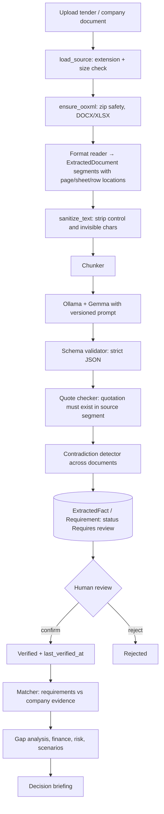

# ProjectIQ Architecture

This document describes the system as designed and marks what exists in the repository today. Legend: **Implemented** = code and tests exist. **Partial** = some code exists. **Planned** = placeholder file only (empty) or not yet created.

## 1. Overview

ProjectIQ is a local-first web application:

```
Browser (React UI, planned)
        │  HTTP/JSON
        ▼
FastAPI backend ──► SQLite (SQLAlchemy 2)
        │
        ├─► File storage  (uploads/, generated/)
        │
        └─► Ollama + Gemma (local, planned)
```

Everything runs on the user's machine. The backend is a single FastAPI process; the database is a local SQLite file; AI inference (planned) is a local Ollama server.

## 2. Component status

| Layer | Module | Responsibility | Status |
|---|---|---|---|
| App shell | `app/main.py` | App factory (`create_app`), `/health`, CORS, mounts routers, creates tables at startup | Implemented |
| Config | `app/config.py` | Typed settings from env / `.env`; resolves storage and database paths | Implemented |
| Persistence | `app/database.py` | Engine, session factory, `get_db` dependency, `init_db`, SQLite foreign-key pragma | Implemented |
| Models | `app/models/company.py`, `project.py`, `document.py`, `requirement.py`, `extracted_fact.py` | Core domain tables | Implemented |
| Models | `models/enums.py`, `mixins.py`, `types.py` | Shared enums, verification/source mixins, money and UTC datetime types | Implemented |
| Models | `risk.py`, `scenario.py`, `financial_model.py`, `resource.py`, `artifact.py`, `audit.py` | Risk, scenario, finance, resource, generated-artifact and audit tables | Planned (empty) |
| Schemas | `app/schemas/base.py` | Pydantic base classes (`ORMModel`, `RequestModel`) | Implemented; no concrete schemas yet |
| API | `app/routers/__init__.py` | Auto-discovers and mounts routers | Implemented |
| API | 13 router modules (`companies`, `projects`, `documents`, `requirements`, `fit`, `financials`, `risks`, `scenarios`, `briefing`, `chat`, `reports`, `resources`, `settings`) | REST endpoints | Planned (empty) |
| Ingestion | `services/ingestion/sanitizer.py` | Shared result types, exceptions, text sanitising, size and zip-safety checks | Implemented |
| Ingestion | `pdf_reader`, `docx_reader`, `xlsx_reader`, `text_reader`, `chunker` | Format readers returning `ExtractedDocument`; chunking for prompts | Planned (empty) |
| AI | `services/ai/ollama_client.py`, `extractor`, `explainer`, `drafter`, `qa`, `prompts/*.txt` | Local model access, extraction, explanation, drafting, Q&A | Planned (empty) |
| Verification | `quote_checker`, `schema_validator`, `contradiction` | Check AI output against sources and schema; detect conflicts | Planned (empty) |
| Analysis | `requirement_matcher`, `gap_detector`, `workforce_gap`, `equipment_options`, `risk_scoring` | Company-vs-tender matching, gaps, risk scores | Planned (empty) |
| Finance | `cost_model`, `bid_pricing`, `breakeven`, `cashflow`, `scenarios` | Deterministic financial calculations | Planned (empty) |
| Export | `csv_export`, `docx_builder`, `pptx_builder` | Briefing and register exports | Planned (empty) |
| Utils | `logging`, `timing`, `units_currency` | Cross-cutting helpers | Planned (empty) |
| Frontend | `frontend/src/**` | Dashboard, wizard, company profile, project tabs, charts, source viewer, Ask-AI panel | Planned (empty) |
| Ops | `docker-compose.yml`, `scripts/*.ps1` | Local setup and startup | Planned (empty) |
| Eval | `eval/run_eval.py`, `demo-data/` | Extraction evaluation against a demo answer key | Planned (empty) |

## 3. Backend design

### 3.1 Application factory

`create_app(cors_origins=None, init_database=True)` builds the FastAPI app. `init_database=False` skips table creation so tests never touch the real SQLite file. Table creation runs in the lifespan handler via `init_db()`, imported lazily because `app.database` builds its engine at import time.

Only `GET /health` is defined today. CORS allows `localhost` / `127.0.0.1` on ports 5173 and 3000.

### 3.2 Router auto-discovery

Every module in `app/routers/` that exposes a module-level `router` (an `APIRouter`) is mounted automatically, in alphabetical order. Modules starting with `_` and modules without a `router` attribute are skipped. A `router` that is not an `APIRouter`, or an import error inside a router module, **fails startup loudly** instead of silently dropping endpoints. Adding an endpoint group therefore means adding one file; `main.py` does not change.

### 3.3 Configuration and storage

Settings come from environment variables and an optional `.env` (repo root, then `backend/`). `STORAGE_DIR` holds `uploads/`, `generated/` and, by default, the SQLite file. Relative paths resolve against `backend/`, so behaviour does not depend on the launch directory.

### 3.4 Persistence

SQLAlchemy 2.0 declarative models with a naming convention for constraints. SQLite connections enable `PRAGMA foreign_keys=ON`, because SQLite ignores foreign keys otherwise. In-memory SQLite shares one connection (`StaticPool`) so tables persist per engine in tests. Schema is created with `create_all`; there are no migrations yet. See [DATABASE.md](DATABASE.md).

## 4. Data flow (target design)



Failure at any early stage calls `Document.mark_failed(reason)`; a failed document always carries a reason (database constraint).

**Implemented today:** the validation helpers, sanitiser and result types (first three boxes' building blocks) and the persistence layer at the bottom. The readers, AI, verification and analysis stages are planned.

### 4.1 Ingestion contract

Every reader returns an `ExtractedDocument`:

- `segments`: `TextSegment` items (`page`, `paragraph`, `heading`, `table_row`, `row`) each with `page_number` and a free-form `location_ref` (for example `page 3`, `Sheet BOQ!A14:D14`, `lines 10-14`) that map onto `SourceLocationMixin` columns, so a finding can cite its source and the quote checker can find the quotation again.
- `status`: `ok`, `empty` (genuinely blank) or `no_extractable_text` (PDF with pages but no text layer; OCR is not implemented).
- `warnings`: sanitiser removals are reported, never silent.
- `to_marked_text()`: text with `[Page N]` / `[Sheet: X]` markers for prompts.

Readers **raise** typed exceptions (`UnsupportedFormatError`, `CorruptDocumentError`, `EncryptedDocumentError`, `ResourceLimitError`, `TextDecodingError`, `ExtractionFailedError`); the caller converts them into `Document.mark_failed(str(exc))`.

## 5. Evidence and verification model

Two independent state fields on requirements:

- `match_status`: how the company compares (`Met`, `Partially met`, `Not met`, `Unknown`, `Not applicable`); default `Unknown`, never upgraded on keyword overlap.
- `verification_status`: whether a person reviewed the item (`Verified`, `Estimated`, `Assumption`, `Missing`, `Conflicting`, `Requires review`, `Outdated`, `Rejected`); default `Requires review`.

Database rules back this up: extracted facts cannot be stored without a non-blank quotation and value; a `Verified` row must have a `last_verified_at`; `quote_verified` is tri-state (not checked / passed / failed).

## 6. AI integration (planned)

- **Runtime**: Gemma served by a local Ollama instance; the backend talks to it over localhost HTTP through `ollama_client`. No configuration for this exists yet in `config.py`.
- **Tasks**: requirement extraction, deadline extraction, risk extraction, briefing generation, question answering, explanation and drafting. Prompts live in `services/ai/prompts/` as versioned text files and are described in [PROMPTS.md](PROMPTS.md).
- **Guardrails**: the model proposes, deterministic code disposes. Output must pass schema validation and quote checking before it is stored; stored output starts as *Requires review*; the extractor name/version is recorded on each fact and requirement (`extractor` column).
- **Numbers**: financial figures come from `services/finance` code, not from model output.
- **Untrusted text**: document content is data. It is sanitised before use, and prompts must treat it as quoted material rather than instructions (see [SECURITY_PRIVACY.md](SECURITY_PRIVACY.md)).

## 7. Frontend (planned)

React + TypeScript (Vite, Tailwind). Planned pages: Dashboard, Company Profile, New Project Wizard, Settings, and per-project tabs: Overview, Documents, Requirements, Company Fit, Resources, Financials, Bidding, Risks, Scenarios, Briefing, Reports. Shared components include status badges, source chips and a source viewer, job-progress indicator, charts (cash flow, cost breakdown, risk matrix, scenario comparison), an Ask-AI panel and a disclaimer footer. None of this is implemented.

## 8. Testing

59 tests in `backend/tests/` cover configuration, database initialisation, the app shell and router discovery, and the core models and their constraints. Tests for the sanitiser, quote checker, matcher, contradiction detector, finance modules, scenarios and prompt-injection handling have placeholder files but no content yet.