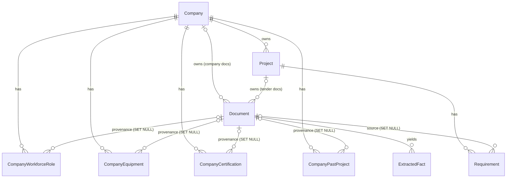

# ProjectIQ Database

Reference for the schema implemented in `backend/app/models/`. SQLite is the default; tables are created by `Base.metadata.create_all` (`init_db`). There are **no migrations yet**.

## 1. Relationships

Deletion behaviour:

| Deleting | Effect |
|---|---|
| Company | Cascades to its profile rows, projects and company documents (and, through projects, to their documents and requirements) |
| Project | Cascades to its documents and requirements |
| Document | Cascades to its extracted facts. Requirements and company profile rows **survive**; their `source_document_id` becomes `NULL` and the quotation stays |

These rules are enforced by database foreign keys (`ON DELETE`), which is why every SQLite connection runs `PRAGMA foreign_keys=ON`.

## 2. Tables

Every table has an integer `id` primary key and `created_at` / `updated_at` (timezone-aware UTC).

### companies

| Column | Type | Notes |
|---|---|---|
| name | String(200) | required |
| legal_name, industry, description, objectives | text-like | optional |
| locations | JSON list | default `[]` |
| year_founded | Integer | optional |
| currency | String(3) | ISO 4217, default from `DEFAULT_CURRENCY`; CHECK length = 3 |
| annual_revenue, working_capital, bank_guarantee_limit | Money | NULL = unknown; CHECK >= 0 |
| financial_constraints | Text | optional |
| field_verification | JSON object | per-field verification map (section 4) |

### company_workforce_roles

Role-level capacity only; no individual employees are stored.

| Column | Notes |
|---|---|
| company_id | FK companies, CASCADE |
| department, role | `role` required; UNIQUE (company_id, department, role) |
| headcount | Integer >= 0, default 0 |
| available_headcount | NULL = unknown; CHECK `0 <= available_headcount <= headcount` |
| skills | JSON list |
| notes | Text |

### company_equipment

`company_id`, `name` (required), `equipment_type`, `quantity` (>= 0, default 1), `capacity`, `ownership` (`owned` / `leased` / `unknown`, default `unknown`), `condition_notes`.

### company_certifications

`company_id`, `name` (required), `issuing_body`, `certificate_number`, `issued_date`, `expiry_date` (CHECK expiry >= issued when both set).

### company_past_projects

`company_id`, `title` (required), `client`, `project_type`, `location`, `description`, `contract_value` (Money, >= 0, NULL = unknown), `currency` (3 letters), `start_date`, `completion_date` (CHECK completion >= start when both set).

The four profile-fact tables above also carry `source_document_id` (FK documents, SET NULL), `source_location` (String 255), `verification_status` and `last_verified_at`.

### projects

| Column | Notes |
|---|---|
| company_id | FK companies, CASCADE |
| name | required |
| category, client, location, description, objectives | optional |
| deliverables, constraints | JSON lists |
| currency, budget | one currency per project; budget Money >= 0, NULL = unknown |
| deadline | timezone-aware UTC datetime |
| status | `draft` (default), `analysing`, `in_review`, `pursuing`, `declined`, `archived` |

### documents

| Column | Notes |
|---|---|
| company_id / project_id | Exactly one must be set (CHECK `exactly_one_owner`) |
| document_type | `tender`, `tender_addendum`, `bill_of_quantities`, `specification`, `contract`, `certificate`, `past_projects`, `equipment_register`, `company_profile`, `other` (default) |
| original_filename | required |
| storage_path | required, **unique**, relative to `storage/uploads/`; the original file is kept untouched |
| mime_type, file_size_bytes (>= 0), page_count (>= 0), version (>= 1, default 1) | |
| sha256 | optional, validated as 64 hex chars and lower-cased; indexed |
| processing_status | `queued` (default), `extracting`, `analysing`, `done`, `failed` |
| processing_error | **required and non-blank when status is `failed`** (CHECK) |
| processed_at, summary | |

`mark_done()` clears the error; `mark_failed(reason)` rejects an empty reason.

### requirements

| Column | Notes |
|---|---|
| project_id | FK projects, CASCADE; UNIQUE (project_id, code) |
| source_document_id | FK documents, SET NULL; NULL for manual requirements |
| code | e.g. `REQ-001` |
| description | required |
| category | `eligibility`, `technical`, `financial`, `certification`, `legal_contractual`, `schedule`, `deliverable`, `documentation`, `evaluation`, `other` (default) |
| is_mandatory | NULL = the source does not say |
| deadline | aware UTC datetime |
| match_status | `Met`, `Partially met`, `Not met`, `Unknown` (default), `Not applicable` |
| evidence_summary, missing_evidence | what supported the match / what would close the gap |
| origin | `extracted` (default) or `manual` |
| extractor | prompt/model version, e.g. `extract_requirements_v1` |
| assigned_role, notes | |
| verification_status, last_verified_at | see section 4 |
| page_number, location_ref, quotation, quote_verified | source reference (section 3) |

### extracted_facts

| Column | Notes |
|---|---|
| document_id | FK documents, CASCADE |
| fact_type | `date`, `cost`, `quantity`, `deliverable`, `role`, `dependency`, `contract_condition`, `eligibility_criterion`, `certification`, `equipment`, `location`, `other` (default) |
| label, value | required, non-blank (CHECK); `value` is as written in the source |
| normalized_value, unit | optional, e.g. ISO date or number |
| quotation | **required, non-blank** (CHECK) |
| extractor | prompt/model version |
| verification fields and source reference | as above |

## 3. Source references

`SourceLocationMixin` (used by requirements and extracted facts) adds `page_number` (>= 1), `location_ref` (free text such as `Sheet BOQ!C14`, `Clause 7(b)`), `quotation` and `quote_verified` (NULL = not checked, true/false = quote-checker result). For extracted facts the quotation is mandatory; for requirements it is optional at the database level.

## 4. Verification

`VerificationStatus` values: `Verified`, `Estimated`, `Assumption`, `Missing`, `Conflicting`, `Requires review`, `Outdated`, `Rejected`.

- New records default to **Requires review**.
- A `Verified` row must have `last_verified_at` (CHECK `verified_has_date`).
- `mark_verified()` sets status and timestamp; `mark_rejected()` sets `Rejected`.
- Scalar `Company` fields use the JSON `field_verification` map instead of columns: `{"annual_revenue": {"status": "Estimated", "last_verified_at": "...", "source_document_id": 3}}`. Only fields in `PROFILE_FIELDS` are accepted. `set_field_verification()` fills the timestamp when marking Verified; `get_field_status()` returns the recorded status, else `Missing` for an empty field, else `Requires review`.

## 5. Conventions

- **Money**: `Numeric(14, 2)`, always `Decimal` in Python, rounded half-up to 2 places; negative, non-finite and values >= 10^12 are rejected. SQLite stores NUMERIC affinity, so exactness is guaranteed only within the tested range (up to 999,999,999,999.99); PostgreSQL would give true decimals.
- **Datetimes**: `UTCDateTime` stores and returns timezone-aware UTC; **naive datetimes are rejected on write**.
- **Enums**: stored as their human-readable *values* (`"Requires review"`), as short strings with a named CHECK constraint, not native enum types.
- **Constraint names** follow `NAMING_CONVENTION` in `database.py` (`ix_`, `uq_`, `ck_`, `fk_`, `pk_`) so future Alembic migrations are predictable.
- **Unknown vs zero**: nullable money, availability and mandatory flags mean *unknown*; zero means zero.

## 6. Planned tables

Models for risks, scenarios, financial models, resources, generated artifacts and an audit log exist as empty files; their schemas are not defined.

## 7. Operations notes

- `create_all` creates missing tables but does **not** alter existing ones. After changing a model during development, delete `backend/storage/projectiq.db` and restart (or run `python -m app.database`) until migrations are introduced.
- Run the module as `python -m app.database`; running the file directly would load `app.database` twice and register models on a different `Base`, creating no tables.